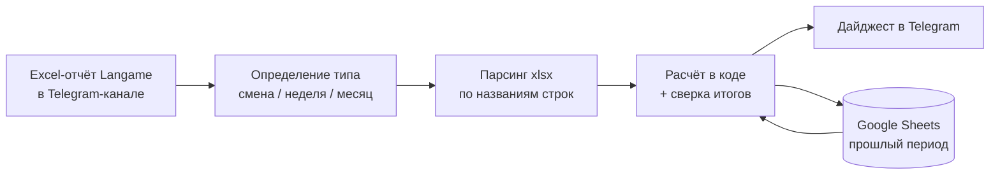
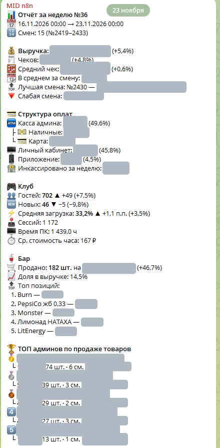
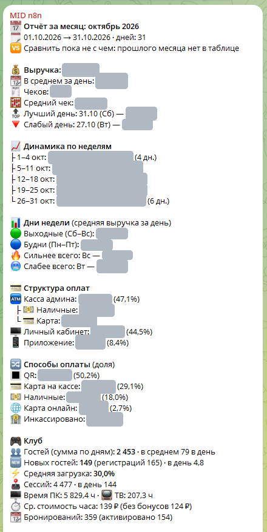

# Руслан Хабиров — AI Automation Engineer

**ИИ-агенты и автоматизация на n8n · Telegram-боты · RAG · парсинг и интеграции**

> 🟢 **Открыт к проектам и удалённой работе.**

Все проекты в этом репозитории собраны под реальные задачи (мой компьютерный клуб и заказчики), а не как учебные заготовки. В репозитории лежат воркфлоу для импорта, код расчётных нод, системные промпты и скриншоты результата.

---

## 🤝 Что я могу сделать для вас

| Задача | Что получите | Примеры из портфолио |
|---|---|---|
| **Автоматические отчёты** | Excel, CRM или таблица превращаются в готовый дайджест в Telegram с динамикой к прошлому периоду | • [Сменный и недельный дайджест](./langame-shift-week-digest/) • [Ежемесячный дайджест](./langame-monthly-digest/) |
| **Мониторинг внешних данных** | Отзывы, конкуренты, цены собираются по расписанию в одно сообщение | • [Мониторинг отзывов Яндекс Карт](./reviews-yandex/) • [Мониторинг отзывов 2ГИС](./reviews-2gis/) |
| **ИИ-ассистент по вашей базе знаний** | Бот отвечает по регламентам и документам со ссылкой на пункт, не выдумывая | • [RAG-ассистент для администраторов](./rag-assistant/) • [Ассистент инженера ВИК](./vik-assistant/) |
| **Голосовой и текстовый секретарь** | Запись клиентов, задачи, финансы, напоминания голосом в Telegram | • [Ассистент мастера маникюра](./nail-technician-assistant/) • [Ассистент руководителя благотворительного фонда](./umar-fund-assistant/) |
| **Контент по расписанию** | Идеи и сценарии без повторов, под сезон и повод | • [Генератор идей для Reels](./reels-generator/) |

Берусь за новые воркфлоу «под ключ», доработку и починку уже существующих, подключение ИИ к вашим процессам.

---

## ⭐ Флагман: система отчётности клуба на n8n

Три сценария превращают выгрузки Langame (Excel) в готовый дайджест в Telegram: смена, неделя, месяц. Система построена под мой клуб и отлажена на его реальных отчётах.

  
  

*Суммы и фамилии сотрудников на скриншотах скрыты.*

**Что в нём важно для заказчика:**
- цифры считает **код, а не нейросеть**: результат воспроизводим, без «выдуманных» чисел;
- итоги **сверяются** по нескольким источникам, при расхождении в сообщении появляется предупреждение;
- сравнение с прошлым периодом хранится в Google Sheets и переживает перезапуск;
- повторная отправка файла не создаёт дублей.

---

## 🧑‍💻 Работаю в связке с Claude

Я ставлю задачу, проектирую процесс и проверяю результат, а **Claude (Anthropic)** ускоряет сборку: пишет и ревьюит код-ноды, помогает отлаживать воркфлоу и тестировать расчёты на реальных данных. Благодаря этому я быстрее довожу прототип до рабочего решения и не оставляю «сырых» мест: каждая цифра в отчётах проходит сверку.

---

## 🧭 Как я работаю

1. **Разбор процесса.** Вместе описываем, как задача решается руками сегодня (при необходимости рисую схему BPMN).
2. **Прототип на ваших данных.** Показываю результат на реальном примере, а не на макете.
3. **Проверка и доработка.** Правки по вашей обратной связи, тесты на крайних случаях.
4. **Запуск и инструкция.** Воркфлоу работает в вашем n8n или на вашем сервере, к нему прилагается инструкция для команды.
5. **Поддержка.** Настраиваю алерты о сбоях и вношу доработки по мере развития процесса.

*Доступы к сервисам подключаются через credentials в вашем n8n. Пароли и токены в переписке я не прошу и не храню.*

---

## 📁 Все проекты

| # | Проект | Суть | Стек | Статус |
|---|---|---|---|---|
| 1 | [Дайджест смен и недель](./langame-shift-week-digest/) | Excel Langame → расчёт в коде → дайджест, ТОП админов, сравнение с прошлым периодом | n8n, Telegram, Google Sheets, JavaScript | ✅ в работе |
| 2 | [Ежемесячный дайджест](./langame-monthly-digest/) | Посуточный отчёт → аналитика, рейтинг напитков, «что изменилось» к прошлому месяцу | n8n, Telegram, Google Sheets, JavaScript | ✅ в работе |
| 3 | [Отзывы Яндекс Карт](./reviews-yandex/) | Еженедельный мониторинг по 6 клубам, защита от капчи и сбоев | n8n, HTTP, парсинг HTML, DeepSeek, Telegram | ✅ в работе |
| 4 | [Отзывы 2ГИС](./reviews-2gis/) | Сбор через Apify по всем клубам, дайджест за неделю | n8n, Apify API, DeepSeek, Telegram | ✅ в работе |
| 5 | [Генератор идей для Reels](./reels-generator/) | Идеи для коротких видео каждые 12 часов, без повторов | n8n, DeepSeek, Telegram | ✅ в работе |
| 6 | [RAG-ассистент для администраторов](./rag-assistant/) | Ответы по регламенту со ссылкой на пункт, эскалация руководителю | n8n, Qdrant, Embeddings, Telegram | ✅ в работе |
| 7 | [Ассистент инженера ВИК](./vik-assistant/) | Мультимодальный (текст, фото, голос) строгий RAG по нормативу | n8n, Qdrant, Vision, Whisper | ✅ в работе |
| 8 | [Ассистент мастера маникюра](./nail-technician-assistant/) | Запись клиентов голосом и текстом, расписание, напоминания | n8n, Whisper, Google Sheets | ✅ в работе |
| 9 | [Ассистент руководителя благотворительного фонда](./umar-fund-assistant/) | Учёт финансов и задач голосом и текстом, голосовые ответы (TTS) | n8n, Whisper, TTS, Google Sheets | ✅ в работе |

---

## 🛡 Принципы, по которым я строю агентов

1. **Расчёты в коде, текст у модели.** Выручка, чеки, рейтинги и сравнения считает JavaScript и воспроизводимо. LLM подключается для выводов и тем (отзывы, идеи), но не для арифметики.
2. **Сверка перед отправкой.** Итоги проверяются несколькими способами. Если не сходится, в сообщении предупреждение, а не молчаливая ошибка.
3. **Алерты вместо тишины.** Пустые данные, капча или сбой API приводят к понятному сообщению, а общий error-workflow ловит остальное.
4. **Состояние в Google Sheets.** Прошлый период не теряется при перезапуске; повторная отправка обновляет запись, а не дублирует.
5. **Строгий RAG.** Ассистент отвечает только по базе знаний, называет источник и честно говорит «не знаю».
6. **Секреты вне кода.** В репозитории только заглушки (`YOUR_…`), токены и ID чатов подставляются в n8n.

---

## 🛠 Навыки

- **Оркестрация:** n8n (Code, IF, Switch, Merge, Schedule, Webhook, Error Trigger), сабворкфлоу, обработка ошибок и ретраи
- **AI:** Claude (Anthropic) как рабочий инструмент для проектирования, код-нод, отладки и ревью; AI Agent, системные промпты и структурированный вывод, DeepSeek, OpenAI-совместимые API, Whisper, TTS, Vision
- **RAG:** Qdrant, Embeddings, строгий RAG со ссылкой на источник
- **Данные и парсинг:** XLSX, HTML, REST API, Apify, JavaScript
- **Интеграции:** Telegram Bot API, Google Sheets, HTTP и вебхуки
- **Инфраструктура:** self-hosted n8n на VPS (Docker, Traefik, HTTPS), Linux
- **Процессы:** BPMN 2.0, декомпозиция бизнес-процессов под автоматизацию

---

## 🎓 Образование и опыт
- Высшее образование: «Нефтегазовое дело»
- Яндекс Практикум: «ИИ-агенты и автоматизация» (курс пройден)
- Опыт в нефтегазовой отрасли (супервайзер-технолог по ремонту скважин), владелец компьютерного клуба: бизнес-процессы знаю изнутри и ставлю задачи как заказчик

## 📬 Контакты
- **Telegram:** [@ai_bot102](https://t.me/ai_bot102)
- **Email:** khabirov111@gmail.com
