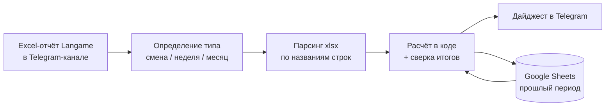

# AI Agents Portfolio — Руслан Хабиров

**AI Automation Engineer.** Собираю ИИ-агентов и автоматизации в n8n для малого бизнеса: отчёты, мониторинг отзывов, контент, ассистенты в Telegram. Все проекты ниже собраны под реальные задачи (мой клуб и заказчики), а не как учебные заготовки.

> 🟢 Ищу удалённую работу и проекты по автоматизации и ИИ-агентам (n8n, Telegram-боты, RAG, парсинг, интеграции).
> Контакты: Telegram [@ai_bot102](https://t.me/ai_bot102) · khabirov111@gmail.com

---

## 💡 Чем я полезен
- Превращаю ручную рутину (отчёты, сверки, мониторинг, ответы на одни и те же вопросы) в автоматические воркфлоу.
- Делаю так, чтобы агент **считал правильно**: цифры считает код, а языковая модель пишет только текст там, где она действительно нужна.
- Закладываю защиту: сверка итогов, алерты вместо тишины при сбое, повторная отправка без дублей, сравнение с прошлым периодом.
- Понимаю бизнес-сторону: опыт в нефтегазе (ремонт скважин), владелец компьютерного клуба. Задачи ставлю и проверяю как заказчик.

---

## ⭐ Флагман: система отчётности клуба на n8n

Три воркфлоу превращают выгрузки из Langame (Excel) в готовый дайджест в Telegram с динамикой к прошлому периоду.

| Воркфлоу | Что делает |
|---|---|
| [Смена + неделя](./langame-shift-week-digest/) | Дайджест смены и недели, ТОП админов по продажам бара, сравнение с прошлой сменой/неделей |
| [Месяц](./langame-monthly-digest/) | Месячный дайджест: динамика по неделям, будни и выходные, рейтинг напитков, разбор «из-за чего изменилась выручка» |

На скриншотах суммы и фамилии сотрудников скрыты.

---

## 📁 Все проекты

| # | Проект | Суть | Стек |
|---|---|---|---|
| 1 | [Дайджест смен и недель](./langame-shift-week-digest/) | Excel из Langame → расчёт в коде → дайджест, ТОП админов, сравнение с прошлым периодом | n8n, Telegram, Google Sheets, JavaScript |
| 2 | [Месячный дайджест](./langame-monthly-digest/) | Посуточный отчёт за месяц → аналитика и сравнение с прошлым месяцем, рейтинг напитков | n8n, Telegram, Google Sheets, JavaScript |
| 3 | [Отзывы Яндекс Карт](./reviews-yandex/) | Еженедельный мониторинг отзывов по 6 клубам, защита от капчи и сбоев | n8n, HTTP, парсинг HTML, DeepSeek, Telegram |
| 4 | [Отзывы 2ГИС](./reviews-2gis/) | Сбор отзывов через Apify по всем клубам, дайджест по неделе | n8n, Apify API, DeepSeek, Telegram |
| 5 | [Генератор идей для Reels](./reels-generator/) | Идеи коротких видео каждые 12 часов с учётом сезона, праздников и истории | n8n, DeepSeek, Telegram |
| 6 | [RAG-ассистент для администраторов](./rag-assistant/) | Ответы по регламенту клуба со ссылкой на пункт, эскалация руководителю | n8n, Qdrant, Embeddings, Telegram |
| 7 | [Ассистент инженера ВИК](./vik-assistant/) | Мультимодальный (текст, фото, голос) строгий RAG по нормативу | n8n, Qdrant, Vision, Whisper |
| 8 | [Ассистент мастера маникюра](./nail-technician-assistant/) | Запись клиентов голосом и текстом, расписание, напоминания | n8n, Whisper, Google Sheets |
| 9 | [Ассистент руководителя фонда](./umar-fund-assistant/) | Учёт финансов и задач голосом и текстом, голосовые ответы (TTS) | n8n, Whisper, TTS, Google Sheets |

---

## 🧭 Как я строю агентов
1. **Расчёты в коде, текст у модели.** Выручка, чеки, рейтинги и сравнения считаются JavaScript-кодом и воспроизводимы. LLM подключается для выводов и тем (отзывы, идеи), а не для арифметики.
2. **Сверка перед отправкой.** Итоги проверяются несколькими способами (по каналам, по способам оплаты, по позициям). Если не сходится, в сообщении предупреждение, а не молчаливая ошибка.
3. **Алерты вместо тишины.** При пустых данных, капче или сбое API приходит понятное сообщение, а общий error-workflow ловит остальное.
4. **Состояние в Google Sheets.** Предыдущий период хранится в таблице и не теряется при перезапуске; повторная отправка того же файла обновляет запись, а не дублирует.
5. **Секреты вне кода.** В репозитории только заглушки (`YOUR_...`), токены и ID чатов подставляются в n8n.

---

## 🛠 Навыки
- **Оркестрация:** n8n (Code, IF, Switch, Merge, Schedule, Webhook, Error Trigger), сабворкфлоу, обработка ошибок и ретраи
- **AI:** AI Agent, системные промпты и структурированный вывод, DeepSeek, OpenAI-совместимые API, Whisper, TTS, Vision
- **RAG:** Qdrant, Embeddings, строгий RAG со ссылкой на источник
- **Данные и парсинг:** XLSX, HTML, REST API, Apify, JavaScript
- **Интеграции:** Telegram Bot API, Google Sheets, HTTP/Webhooks
- **Инфраструктура:** self-hosted n8n на VPS (Docker, Traefik, HTTPS), Linux
- **Процессы:** BPMN 2.0, декомпозиция бизнес-процессов под автоматизацию

---

## 🎓 Образование и опыт
- Яндекс Практикум: ИИ-агенты и автоматизация
- Супервайзер-технолог в нефтегазовой отрасли, владелец компьютерного клуба

## 📬 Контакты
- **Telegram:** [@ai_bot102](https://t.me/ai_bot102)
- **Email:** khabirov111@gmail.com
