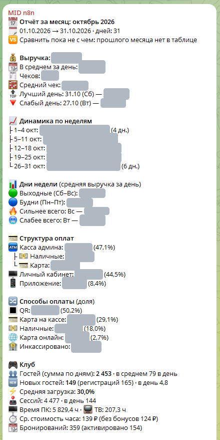
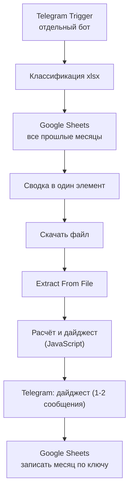

# Langame → месячный дайджест

Раз в месяц в Telegram приходит посуточный отчёт Langame (xlsx). Воркфлоу превращает его в аналитический дайджест и **сравнивает с прошлым месяцем**.

*Суммы на скриншоте скрыты. Показана первая часть сообщения, дальше идут бар, рейтинг напитков, бонусы и блок аналитики.*

## 🎯 Задача
Недельные цифры не показывают общую картину: сезонность, динамику, разницу будней и выходных, что происходит с баром. Нужен месячный срез с понятным ответом на вопрос «что изменилось и почему».

## 🧩 Как работает

## 📊 Что в дайджесте
- Выручка, чеки, средний чек, **в среднем за день**, лучший и слабый день.
- Динамика по неделям месяца, **будни против выходных**, самый сильный и слабый день недели.
- Структура оплат: каналы и способы, доли в процентных пунктах.
- Клуб: гости, новые, загрузка, сессии, часы ПК, стоимость часа.
- Бар и **рейтинг напитков**: место, доля, изменение к прошлому месяцу, кто вырос и кто просел, новые позиции.
- Блок **«Что изменилось»**: на сколько изменилась выручка, из них за счёт числа чеков и за счёт среднего чека, какой канал оплаты изменился сильнее всего.
- Итог в нескольких строках на человеческом языке.

## ✅ Особенности
- **Определение по содержимому:** воркфлоу узнаёт отчёт «Посуточный отчёт» по заголовку, чужие файлы молча пропускает (никаких ложных ошибок).
- **Ключ месяца (`2026-10`):** прошлый месяц ищется по ключу, поэтому повторная отправка того же месяца обновляет строку, а не создаёт дубль.
- **Сравнение в пересчёте на день**, если в месяцах разное число дней; неполный месяц помечается предупреждением.
- **Сверка:** выручка по каналам, по способам оплаты и по позициям бара должны сойтись.
- **Автоматическая разбивка** длинного дайджеста на сообщения (лимит Telegram), аналитика идёт отдельным сообщением.
- **Расчёты в коде, без LLM.**

## 🔧 Стек
n8n · Telegram Bot API · Extract From File (XLSX) · Google Sheets · JavaScript

## ▶️ Как запустить
1. Импортируйте `workflow.json`, подключите Telegram (бот для приёма файлов и бот для отправки) и Google Sheets.
2. Создайте таблицу, лист «Лист1», заголовки: `Месяц | Название | Дайджест | Данные`, укажите её в нодах «Прошлые месяцы» и «Сохранить месяц».
3. Задайте ID канала (`-1001234567890`) или присылайте файл боту в личку.
4. Активируйте воркфлоу и отправьте отчёт.

## 📁 Файлы
- `workflow.json`: воркфлоу для импорта (идентификаторы заменены на заглушки)
- `calc-node.js`: код расчётной ноды отдельным файлом
