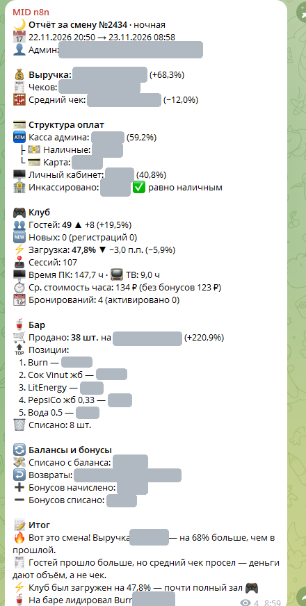
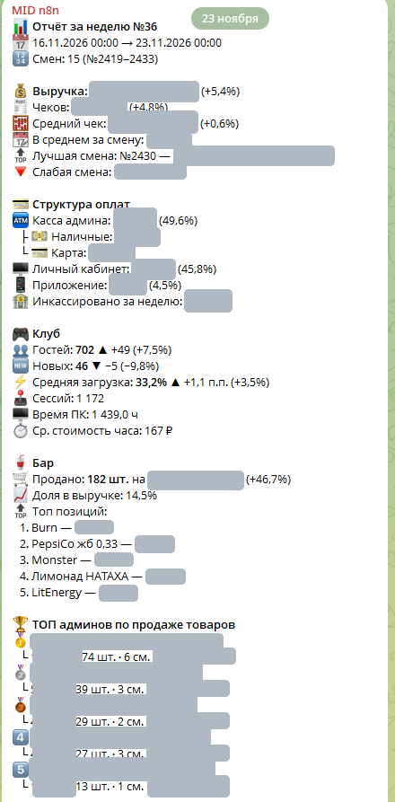
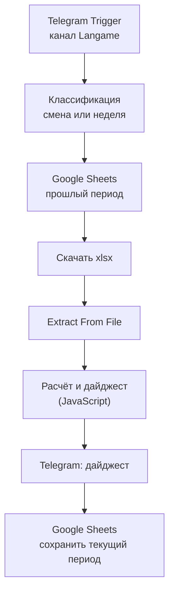

# Langame → дайджест смены и недели

Один воркфлоу вместо двух: слушает Telegram-канал, куда Langame присылает Excel-отчёты, определяет тип файла (смена или неделя) и присылает готовый дайджест с динамикой к прошлому периоду.

*Суммы и фамилии сотрудников на скриншотах скрыты.*

## 🎯 Задача
Раньше отчёты по сменам и неделям собирались вручную: открыть Excel, найти нужные строки, посчитать, сравнить с прошлым разом. Нужен был стабильный автомат, которому можно доверять цифры.

## 🧩 Как работает

1. Файл из канала определяется по имени (`Отчет_по_смене_…` или `Отчет_по_неделе_…`), остальное игнорируется.
2. Из Google Sheets подтягивается JSON прошлого периода.
3. Код-нода разбирает xlsx **по названиям строк**, а не по номерам: добавление строки в отчёте Langame не ломает парсер.
4. Считаются выручка, чеки, средний чек, структура оплат, загрузка, гости, бар, бонусы и возвраты.
5. В недельном отчёте дополнительно строится **ТОП администраторов по продаже товаров**.
6. К каждому показателю добавляется динамика к прошлой смене или неделе (▲▼ и проценты).
7. Дайджест уходит в Telegram, а текущий период сохраняется в таблицу как база для следующего сравнения.

## ✅ Особенности
- **Вся арифметика в коде, без LLM:** результат детерминирован и воспроизводим, нет «галлюцинаций» в цифрах.
- **Сверка итогов:** выручка по каналам и по способам оплаты, инкассация и наличные. При расхождении в начале сообщения появляется предупреждение.
- **Сравнение хранится в Google Sheets**, а не в памяти воркфлоу, и переживает перезапуски n8n.
- **Единый триггер на канал:** один Telegram Trigger и один воркфлоу вместо двух отдельных, которые слушали один и тот же канал.
- **Форматирование под Telegram (HTML):** одна метрика в строке, эмодзи-иконки, ровные блоки.
- **Error workflow** на уровне настроек: любой сбой приходит уведомлением.

## 🔧 Стек
n8n · Telegram Bot API · Extract From File (XLSX) · Google Sheets · JavaScript (Code node)

## ▶️ Как запустить
1. Импортируйте `workflow.json` в n8n.
2. Подключите свои credentials: Telegram и Google Sheets.
3. Замените заглушки: ID канала (`-1001234567890`, в нодах «Отправить дайджест» и «Классификация»), две таблицы (`YOUR_GOOGLE_SHEET_ID`).
4. В обеих таблицах на листе «Лист1» должны быть заголовки: `Мид | Смена (или Неделя) | Данные`, в строке 2 в колонке «Мид» значение `1`.
5. Активируйте воркфлоу.

## 📁 Файлы
- `workflow.json`: воркфлоу для импорта (идентификаторы заменены на заглушки)
- `calc-node.js`: код расчётной ноды отдельным файлом для чтения
