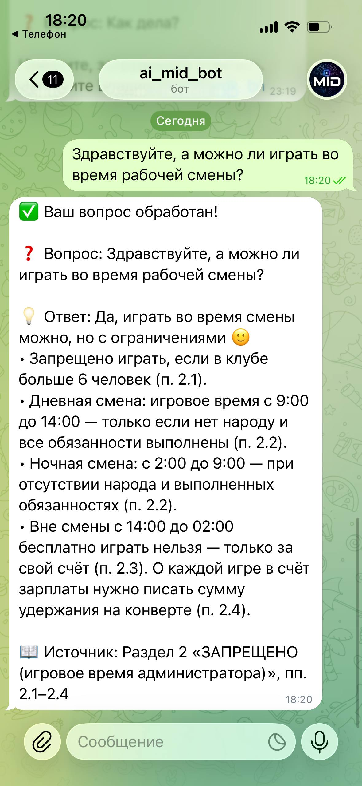
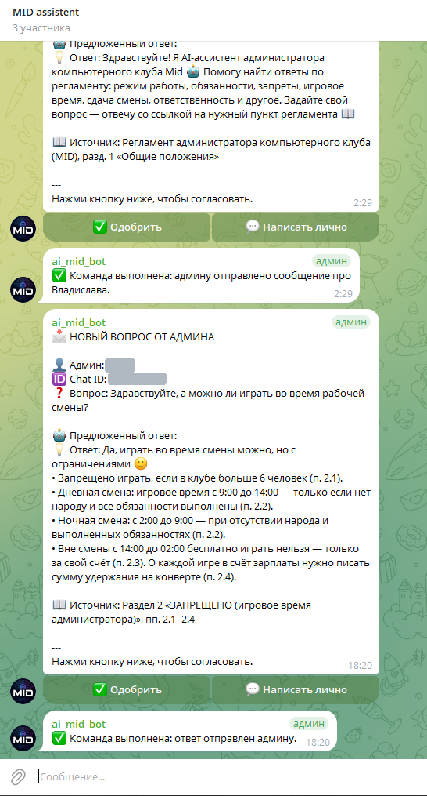

# RAG-ассистент для администраторов клуба

## 🎯 Задача
Администраторы тратят время на поиск ответов в регламентах клуба.

## 💡 Решение
AI-агент в Telegram отвечает на вопросы, используя базу знаний клуба:
1. Админ задаёт вопрос в Telegram.
2. Агент ищет релевантные чанки в Qdrant (RAG).
3. Формирует ответ со ссылкой на пункт регламента.
4. Отправляет в Telegram.

## 🔧 Стек
- n8n
- Qdrant (векторная база)
- Embeddings OpenAI
- DeepSeek Chat Model
- Telegram Bot API
- RAG (Retrieval-Augmented Generation)

## 📊 Результат
- Быстрый ответ на вопрос администратора вместо поиска по длинному регламенту.
- Ответ со ссылкой на конкретный пункт.
- Если уверенности нет, вопрос уходит руководителю на согласование (кнопки «Одобрить» и «Написать лично»).

## 📸 Как это выглядит

  
  

*Слева: ответ администратору со ссылкой на пункт регламента. Справа: вопрос без уверенного ответа уходит руководителю на согласование.*

## 📁 Файлы
- `workflow.json`: воркфлоу (ID чатов, сервисные ссылки и ключи заменены на заглушки)
- `system-prompt.txt`: системный промпт агента
