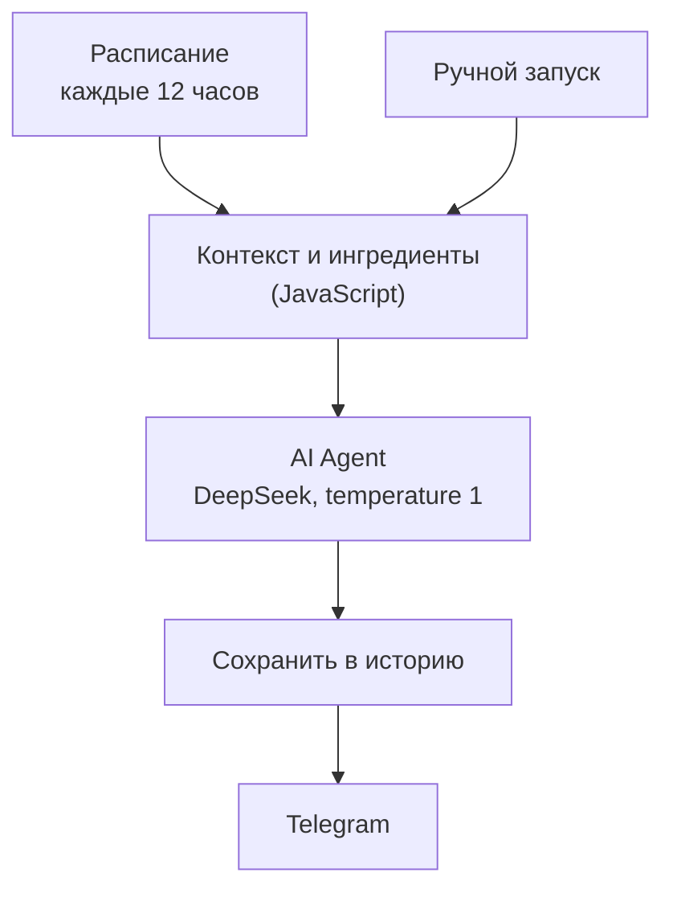

# Генератор идей для Reels / TikTok

Каждые 12 часов в Telegram приходит новая идея короткого видео для клуба: с хуком, раскадровкой, текстом на экране, звуком, призывом и хэштегами. Идеи привязаны к дате, сезону и праздникам и не повторяются.

> 📸 Скриншот результата добавлю после ближайших запусков.

## 🎯 Задача
Первая версия выдавала скучные и «ничьи» идеи. Нужен был поток конкретных, смешных и актуальных сценариев, по которым можно сразу снимать.

## 🧩 Как работает

1. Код собирает контекст: сегодняшняя дата, сезон, ближайшие праздники и **случайный набор «ингредиентов»**: формат ролика, герой, боль гостя, настроение, игра, ограничение.
2. В промпт подаются последние 30 названий, чтобы идеи не повторялись.
3. Агент выдаёт сценарий в строгом формате, ограниченном по длине: название, хук, кадры, текст на экране, звук, CTA, хэштеги, подсказка по съёмке.
4. Название сохраняется в историю, идея уходит в Telegram.

## ✅ Особенности
- **Разнообразие за счёт случайных ингредиентов**, а не просьбы «придумай что-нибудь».
- **Актуальность:** сезон и праздники в контексте.
- **Память:** защита от повторов по последним названиям.
- **Строгий формат** упрощает превращение идеи в видео.

## 🔧 Стек
n8n · DeepSeek (AI Agent, высокая температура) · JavaScript · Telegram Bot API

## 📁 Файлы
- `workflow.json`: воркфлоу для импорта (ID чата заменён на заглушку)
- `system-prompt.txt`: системный промпт агента
