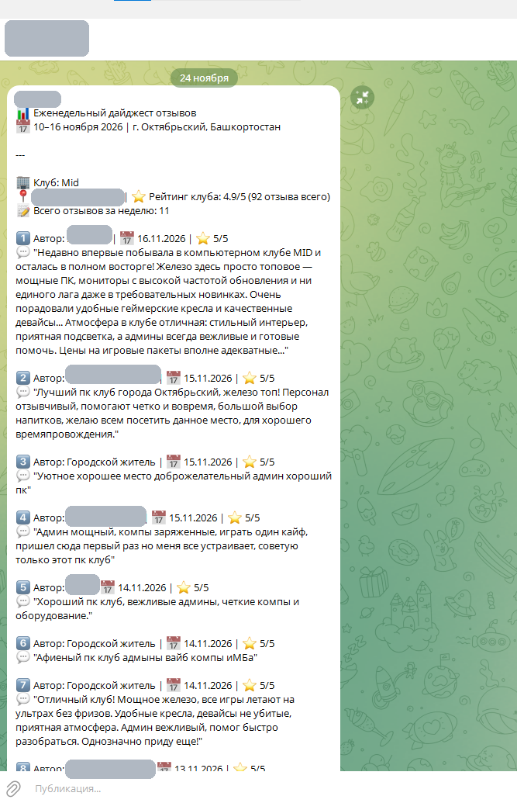
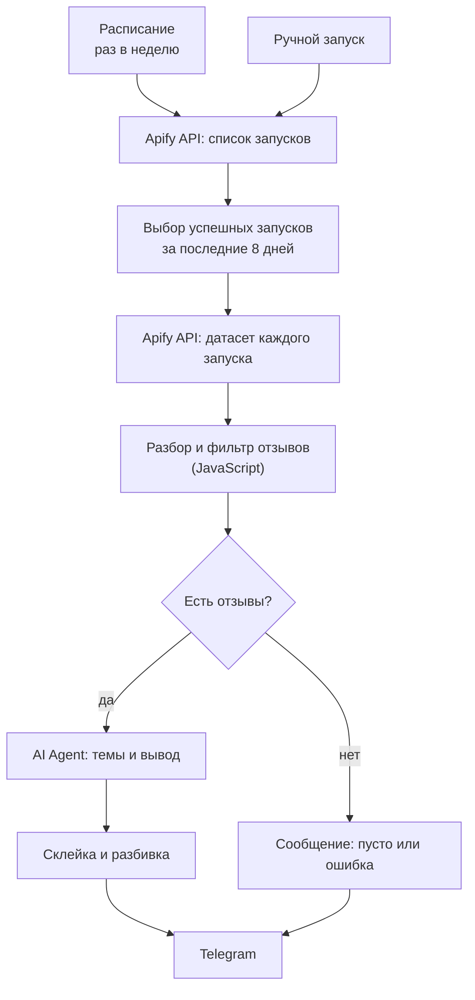

# Мониторинг отзывов 2ГИС через Apify

Еженедельный дайджест новых отзывов о клубах города из 2ГИС. Данные собирает готовый парсер Apify, а воркфлоу забирает результаты, фильтрует свежие отзывы и формирует отчёт.

*Имена авторов отзывов, адрес и название канала скрыты.*

## 🎯 Задача
Видеть отзывы по всем клубам города в одном дайджесте. Первая версия забирала данные только по одному клубу (последний запуск парсера), поэтому логика сбора переписана.

## 🧩 Как работает

1. Из Apify запрашиваются запуски парсера со статусом SUCCEEDED за последние 8 дней.
2. Для **каждого** запуска (то есть каждого клуба) загружается свой датасет.
3. Код объединяет отзывы, нормализует поля (устойчиво к разным названиям ключей) и оставляет отзывы за неделю.
4. DeepSeek формулирует темы и вывод, цифры и факты берутся из данных.
5. Отчёт разбивается на сообщения и уходит в Telegram.

## ✅ Особенности
- **Все клубы, а не один:** объединяются результаты всех успешных запусков.
- **Диагностика:** если структура ответа Apify изменилась, воркфлоу показывает найденные ключи.
- **Не молчит** при отсутствии новых отзывов или ошибке.
- **Токен Apify** хранится в запросе только как заглушка `YOUR_APIFY_TOKEN`; в своём n8n лучше вынести его в credentials.

## 🔧 Стек
n8n · Apify API (2GIS Reviews Scraper) · HTTP Request · JavaScript · DeepSeek · Telegram Bot API

## 📁 Файлы
- `workflow.json`: воркфлоу для импорта (токен и ID чата заменены на заглушки)
- `system-prompt.txt`: системный промпт агента
