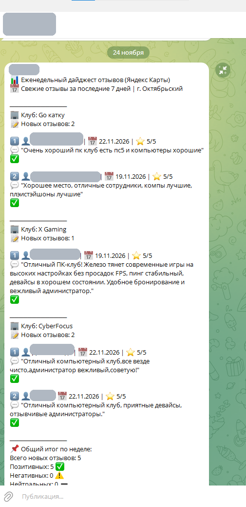
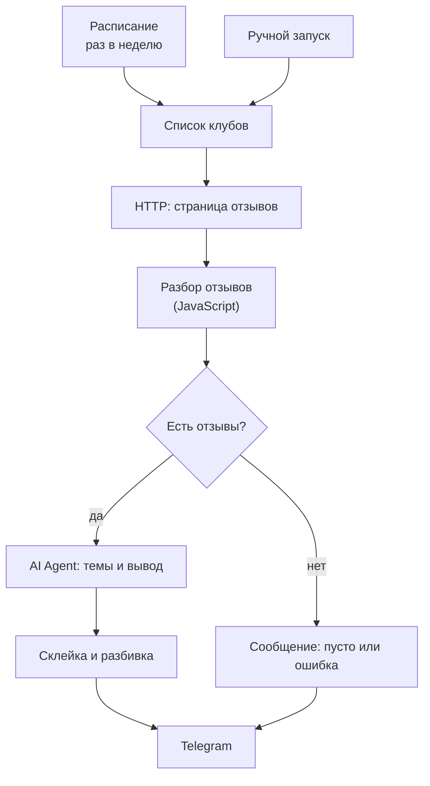

# Мониторинг отзывов Яндекс Карт

Еженедельный дайджест свежих отзывов по нескольким клубам города: мой клуб и конкуренты. Если данных нет или Яндекс отдал капчу, воркфлоу сообщает об этом, а не молчит.

*Имена авторов отзывов и название канала скрыты.*

## 🎯 Задача
Следить, что пишут гости о клубе и конкурентах, без ручного обхода карточек. Первая версия молча перестала присылать отчёты, поэтому воркфлоу переделан с упором на надёжность.

## 🧩 Как работает

1. Список клубов задан в одной ноде: название и ссылка на отзывы, отсортированные по дате.
2. Каждая страница загружается HTTP-запросом (с повторами и паузами между запросами).
3. Код разбирает HTML: достаёт автора, дату, оценку и текст каждого отзыва и оставляет отзывы за последние 7 дней.
4. Нейросеть (DeepSeek) формулирует только ключевые темы и краткий вывод, а факты берутся из разобранных данных.
5. Дайджест режется на сообщения под лимит Telegram и отправляется.

## ✅ Особенности
- **Нет тишины:** при пустой выдаче, капче или изменении вёрстки приходит диагностическое сообщение.
- **Детерминированный разбор отзывов:** сбалансированное извлечение блока каждого отзыва, а не хрупкие регулярки.
- **LLM изолирован:** при сбое модели дайджест всё равно уходит (onError → continue).
- **Ручной запуск** рядом с расписанием для тестов.

## ⚠️ Ограничение
Яндекс может показывать капчу запросам с серверных IP. В этом случае воркфлоу сообщит об этом, и в ноде HTTP можно подключить российский прокси.

## 🔧 Стек
n8n · HTTP Request · JavaScript (парсинг) · DeepSeek · Telegram Bot API

## 📁 Файлы
- `workflow.json`: воркфлоу для импорта (ID чата заменён на заглушку `-1001234567890`)
- `system-prompt.txt`: системный промпт агента
